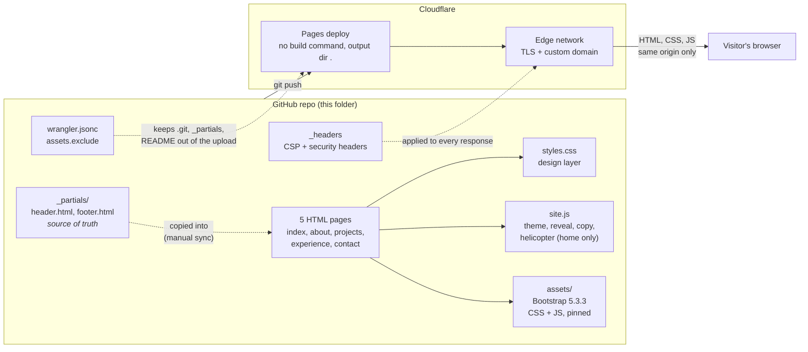
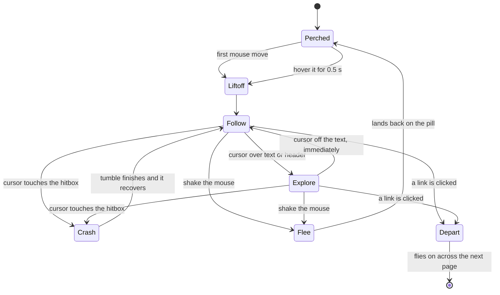

# nathan.andmar.dev

My personal site: five static pages, one stylesheet, one script, no build step.
It is served from Cloudflare's edge and deployed straight from this repo.

**Pages:** Home, About, Projects, Experience, Contact

The look is a cockpit display crossed with a security console: navy panel,
a single teal accent, DIN-style headings, monospace for data, square corners with
HUD-style corner brackets. The home page also has a small UH-1 Huey that follows the
cursor (more on that below).

## How the pieces fit together



### What each piece does

| Piece | Role |
|-------|------|
| `index.html`, `about.html`, `projects.html`, `experience.html`, `contact.html` | The pages. Each one is fully assembled HTML, so there is nothing to render at request time. |
| `_partials/header.html`, `_partials/footer.html` | Source of truth for the nav and footer. Edit these first, then copy into all five pages. |
| `styles.css` | The whole visual design, layered on top of Bootstrap. Colors, type, and spacing are CSS variables at the top of the file, with a light theme overriding the same variables. |
| `pt.js` | Tiny script in each page's `<head>`: parks an incoming page off screen before first paint so it can slide in. |
| `site.js` | Page transitions, footer year, theme toggle (saved in `localStorage` under `site-theme`), scroll reveal, copy-to-clipboard button, and the helicopter. |
| `assets/css`, `assets/js` | Bootstrap 5.3.3, self-hosted and pinned. Used for the grid, navbar, collapse, and accordion. |
| `_headers` | Content Security Policy and other security headers, applied by Cloudflare. |
| `wrangler.jsonc` | Deploy config for `npx wrangler deploy`. Its `assets.exclude` list keeps repo internals out of the published site. |
| `resume.pdf`, `favicon.svg` | Static files served as-is. |

## How it was made

1. **Plain HTML first.** Five pages, hand-written, sharing one nav and footer. No
   framework, no bundler, no package manager. A static site has nothing to compile, so
   deploys are just "upload these files".
2. **Bootstrap for structure only.** The grid, navbar, collapse, and accordion come from
   Bootstrap. Everything you can actually see (palette, type, brackets, plate) lives in
   `styles.css` and overrides Bootstrap's defaults, including its blue accordion colors.
3. **Design tokens, then components.** All colors, radii, and fonts are variables in
   `:root`, with a `[data-bs-theme="light"]` block that swaps the same names. Components
   only use the variables, so the theme toggle is one attribute on `<html>`.
4. **Small, boring JavaScript.** One file, no dependencies, no network calls. Anything
   decorative is skipped for touch devices and for visitors who prefer reduced motion.
5. **Locked down by default.** The CSP only allows resources from this same origin, which
   shapes the code: no inline styles, no CDNs, no web fonts, no analytics.
6. **Deployed from git.** Pushing to `main` triggers a Cloudflare Pages deploy. There is
   no build command, and the output directory is the repo root.

### Design choices

- **Aerospace plus security.** Navy instrument-panel background, one teal accent (like
  cyan data on a glass cockpit), amber reserved for the helicopter's searchlight.
- **Type.** Headings use a DIN-style system stack (Bahnschrift on Windows, DIN Alternate
  on Mac, Arial elsewhere). Dates and labels are monospace. No web fonts are loaded.
- **Structure as information.** Corner brackets mark the content blocks, the hero shows a
  plain-facts "data plate", and section titles end in a drafting tick.
- **Emphasis.** Key phrases step up to full-strength bold text, the headline claims get a
  teal underline, and the stat rows use large teal numerals so the eye lands on facts first.
- **Hover focus.** Cards, timeline entries, the data plate and the CTA step forward slightly under
  the cursor, with a teal border. Nothing else changes.
- **Page transitions.** Clicking a link slides the page content out to the left and the next page in
  from the right (the header stays). If the helicopter is in the air it flies off to the right with
  the page and carries on across the next one until it leaves the screen; if it is landed it just rides
  out with the page. The hand-off between pages is a short-lived `sessionStorage` key, because the
  CSP (`connect-src 'none'`) rules out fetching the next page in the background.
- **Motion.** Sections fade and pop in once as they scroll into view. Everything honors
  `prefers-reduced-motion`.

## The helicopter

On the home page, a UH-1 Huey perches on the "open to opportunities" pill. Move the mouse
and it lifts off and hovers beside the cursor. It lives entirely in `initHelicopter()` in
`site.js` and draws itself as inline SVG, so it adds no files or requests.



| Behavior | How it works |
|----------|--------------|
| Gating | Created only when `body[data-page="home"]`, a fine pointer with hover exists, and reduced motion is off. |
| Sprite | One SVG with four views (side, top, nose-on, rotor) that it switches between while turning or tumbling. |
| Searchlight | A separate `div` with a conic-gradient cone and `mix-blend-mode: screen`, dark theme only, aimed at the cursor. |
| Tilt | Driven by measured acceleration, so it leans forward when pushing and flares back when braking. |
| Walls | A soft margin of one helicopter length from every window edge, plus a hard speed governor. |
| No-go zones | Text, the header, and any box with text in it (cards, the data plate, timeline entries, buttons, tags) are off limits, padding included. The moment the cursor is over one, the helicopter stops chasing and wanders off to a spot low on the page on the far side of itself from the cursor. The moment the cursor leaves, it follows again. There is no delay either way, and its own inertia keeps the turns gentle. |
| Page change | Clicking a link while it is in the air sends it nose-right toward the right side as the page slides out, and it carries on across the next page until it leaves the screen. A landed helicopter rides out with the page instead. See the page transitions note under design choices. |
| Dismiss | Shake the mouse back and forth. It flies home and lands on the pill. If the pill scrolls off screen it flies up and waits there. |

Tuning constants such as `MAX_SPEED`, `HELI_LEN`, and `SHAKE_NEED` are named at the top of
`initHelicopter()`.

## Security posture

- **No third-party requests.** Bootstrap is self-hosted in `assets/` and pinned to 5.3.3.
- **Three scripts, besides Bootstrap**, all served from this domain:
  - `assets/js/bootstrap.bundle.min.js`: upstream Bootstrap, unmodified
    (sha256 `0833b2e9c3a26c258476c46266e6877fc75218625162e0460be9a3a098a61c6c`)
  - `pt.js`: page-transition boot (runs in `<head>`)
  - `site.js`: everything above
- **Pinned stylesheet:** `assets/css/bootstrap.min.css`
  (sha256 `3c8f27e6009ccfd710a905e6dcf12d0ee3c6f2ac7da05b0572d3e0d12e736fc8`)
- **CSP** (`_headers`): `default-src 'self'`, `script-src 'self'`, `style-src 'self'`,
  `connect-src 'none'`, `frame-ancestors 'none'`. That means no inline `<style>` or
  `style=""` attributes in markup (setting `el.style` from JavaScript is fine).
- **No backend.** Contact is a `mailto:` link, with no forms and no fake "message sent" states.

## Working on it

### Run it locally

```sh
python3 -m http.server 8000
```

Open <http://localhost:8000>. The CSP is not enforced locally, so check for inline styles
yourself. If a CSS change does not show up, hard-reload (`Ctrl+Shift+R`): Python's server
sends no cache headers and browsers hold on to the stylesheet.

### Keeping the nav and footer in sync

Pages are fully assembled HTML (Cloudflare Pages does not expand `<!--#include-->`). When
you change the nav or footer, edit `_partials/` first, then copy the block into all five
pages. Check for drift:

```sh
for f in index about projects experience contact; do
  diff <(sed -n '/<header class="site-header/,/<\/header>/p' _partials/header.html) \
       <(sed -n '/<header class="site-header/,/<\/header>/p' $f.html) >/dev/null \
    && echo "$f: nav OK" || echo "$f: NAV DRIFT"
  diff <(sed -n '/<footer/,/<\/footer>/p' _partials/footer.html) \
       <(sed -n '/<footer/,/<\/footer>/p' $f.html) >/dev/null \
    && echo "$f: footer OK" || echo "$f: FOOTER DRIFT"
done
```

### Deploy (Cloudflare Pages, free)

1. Push this repo to GitHub.
2. Cloudflare, then **Workers & Pages**, **Create application**, **Pages**, connect the repo.
   Build command: *none*. Build output directory: `.`
3. In the Pages project, open **Custom domains** and add `nathan.andmar.dev`.
   Cloudflare creates the CNAME and the certificate automatically.

Or deploy from a terminal with `npx wrangler deploy`.

### Deploy gotchas

Both of these broke a real deploy:

- **`_headers` format.** A path glob line, followed by 2-space-indented `Name: value`
  lines. No comments are allowed: every non-blank line must parse as a glob or a header
  pair, or the deploy fails with error 100324.
- **`wrangler.jsonc` `assets.exclude` is load-bearing.** It keeps `.git/`, `_partials/`,
  this README, and the config itself out of the published assets. Wrangler reads no ignore
  file, so if the list is removed the whole repo, git objects included, gets published.
  Anything else you add to the repo root that should not go public (reference images,
  notes) must be added here too.
